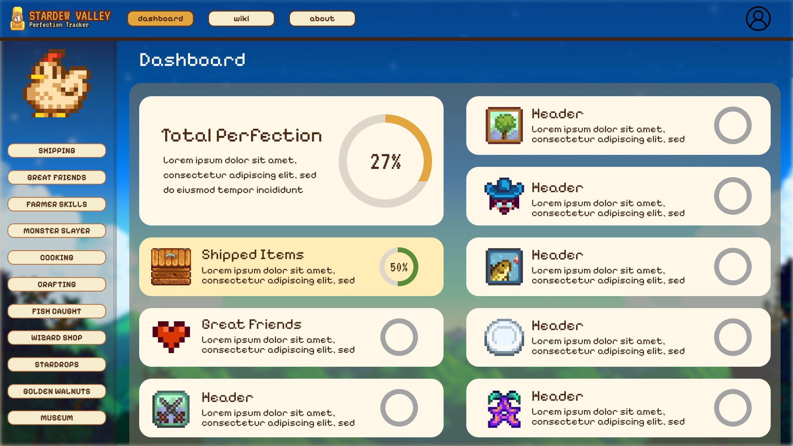
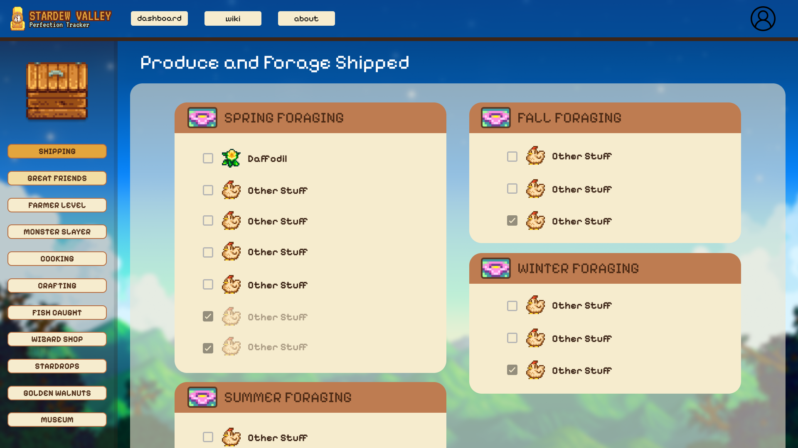
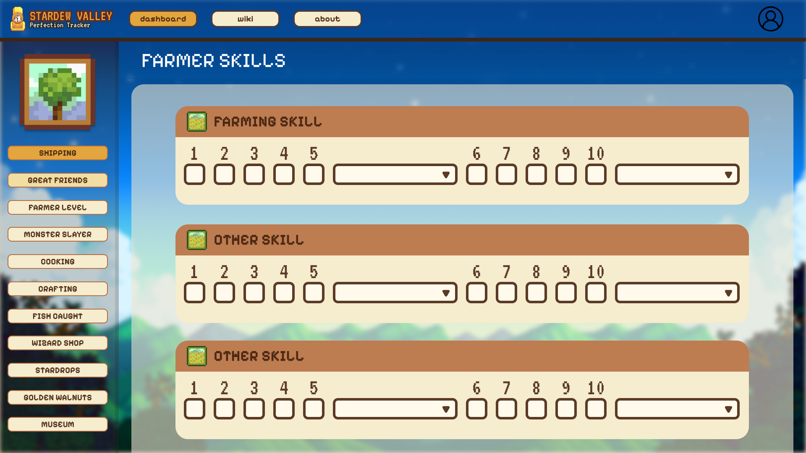

# Mockup

What the Stardew Valley Perfection Tracker looks like: the wireframes painted in
with the colours, type and spacing from the
[design system](03-design-system.md) ([PDF](assets/03-design-system.pdf)).

Almost every page shares one layout (top bar, sidebar, cream cards on a
translucent panel), so I made one mockup per **layout** instead of one per page.
The table below shows which mockup covers which of the 13 screens, so nothing in
the app is left out.

## Mockups

### 1. Dashboard

The home screen. An overall progress summary and one card per category, each with
a progress ring that fills green and turns gold at 100%. Each card links to its
tracker page.

### 2. Lists

The checklist screens, shown with Produce and Forage Shipped. Brown-headed cream
cards hold checkbox rows, grouped the way the game groups them (here by season),
in two columns. A checked item fades but keeps a solid box so its state stays
clear.

### 3. Skills

The Farmer Skills screen. Each skill card has level checkboxes 1 to 5 and 6 to 10,
with a profession select after each group of five, instead of a plain list.

## Which mockup covers which screen

| Screen | Route | Layout | Mockup |
| --- | --- | --- | --- |
| Dashboard | `/` | Summary cards | Dashboard |
| Produce Shipped | `/shipped` | Grouped checklist | Lists |
| Golden Walnuts | `/golden-walnuts` | Grouped checklist | Lists |
| Fish Caught | `/fish` | Grouped checklist | Lists |
| Bundles | `/bundles` | Grouped checklist | Lists |
| Cooking Recipes | `/cooking` | List | Lists |
| Crafting Recipes | `/crafting` | List | Lists |
| Museum | `/museum` | List | Lists |
| Farm Progress | `/farm-progress` | Card grid | Lists |
| Monster Slayer | `/monster-slayer` | Card grid | Lists |
| Great Friends | `/great-friends` | Card grid | Lists |
| Farmer Skills | `/farmer-level` | Skill tracker | Skills |
| About | `/about` | Single card | Lists |

## Design choices

- **Colours:** nav blue `#0b4a8f`, cream `#fdf6e3` and `#f6ecd0`, ink brown
  `#4a2a14`, gold `#e3a43a`, green `#4f8a35`. Full list with contrast checks in the
  [design system](03-design-system.md#colour).
- **Type:** Pixelify Sans for titles, labels and buttons; Nunito for body text.
- **Spacing:** a rem scale of 0.25, 0.5, 0.75, 1, 1.5 and 2.

## Differences from the built app

- **Sidebar items.** The mockup sidebar lists Wizard Shop and Stardrops, which are
  not pages in the app (Stardrops are tracked inside Farm Progress and
  auto-checked), and it leaves out Farm Progress and Bundles, which the app has.
- **Item sprites.** The mockup shows a sprite beside each checklist item (a
  placeholder chicken stands in for most of them). I did not get to adding item
  sprites to the app.
- **Profile icon.** The mockup top bar has a user icon. The app has no accounts
  or login, so it was left out.